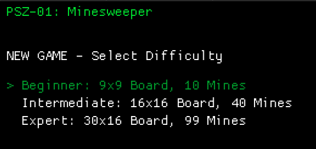
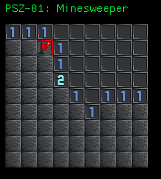
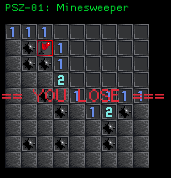

# Code Walkthrough zu PSZ Praktikum 1: Minesweeper Spiel

## Abgabe von Gruppe 4 Teilnehmer:
- Laurin Trapp
- Jörn Johannsen
- Aurelia Nejati Masouleh
- Anton Tchekov

## Welche Frameworks wurden verwendet?

- Macroquad (https://macroquad.rs/)

Simple and easy to use game library for Rust programming language.

## Was ist nativer Rust-Code?

Rust ist eine kompilierte Sprache, die direkt für die
CPU-Architektur und Platform kompiliert wird, und
ohne Runtime auskommt (wie es etwa bei Java der Fall ist)

## In welcher Entwicklungsumgebung wurde gearbeitet?

- Visual Studio Code

## Wie kann dass Ergebnis verwendet werden?

Dass Spiel kann mit dem folgenden Befehl gestartet werden:

```
cargo run
```

Im Menü kann die gewünschte Schwierigkeitsstufe
mit Pfeiltasten und Enter ausgewählt werden.



Mit Linksklick könnnen Felder aufgedeckt werden.
Mit Rechtsklick können Felder markiert werden.
Die Zahlen zeigen an, wie viele Minen sich im Umfeld befinden.
Man kann das Spiel jederzeit mit Escape verlassen, um zum
Menü zurückzukehren.



Wenn man ein Feld mit einer Mine aufdeckt, hat man
verloren.



Hat man alle Felder (außer die Minen) aufgedeckt,
hat man gewonnnen.

## Beobachtungen aus der Implementierung

### Unterschiede zu anderen Programmiersprachen

- match statt switch
- Keine do-while Schleife (Kann mit while Expression umgesetzt werden)
- Statt Klassen struct und impl

### Vorteile von Rust (Meiner Meinung)

- Memory Safety
	- Borrow Checker
	- Array Bounds Checking

- Option und Result Typen
	- Statt Exceptions
	- Kein null

- Kontrollstrukturen können in Expressions verwendet werden

### Nachteile von Rust (Meiner Meinung)

Eher kleinere nervige Punkte:

- Variablen müssen mit `mut` deklariert werden, ansonsten sind es Konstanten by Default
	- Verursacht häufig Kompilierfehler, da man es oft vergisst

- Typumwandlungen müssen immer gecastet werden, auch wenn die Konvertierung nicht verlustbehaftet ist (z.B. u8 nach u32)
	- "Clutter" im Code

- Variablentypen müssen nicht angegeben werden
	- Nachteil beim Lesen vom Code, da man nicht direkt sehen kann welcher Typ eine Variable hat
	- Besonders bei Rückgabewerten von importierten Funktionen schwierig

## Code Walkthrough Dokumentation

Erste Zeile: Import der Game Library

```rust
use macroquad::prelude::*;
```

Definition der Spielfeldgröße und Positon als Konstanten:

```rust
const MAX_W: usize = 30;
const MAX_H: usize = 16;
const MAX_N: usize = MAX_W * MAX_H;
const TILE_SIZE: f32 = 32.0;
const OX: f32 = 10.0;
const OY: f32 = 50.0;
```

Definition des Spielfelds:

```rust
#[derive(Copy, Clone, PartialEq)]
enum TileState
{
	Hidden,
	Revealed,
	Flagged
}

#[derive(Copy, Clone, PartialEq)]
enum TileKind
{
	Mine,
	Digit(u8)
}

#[derive(Copy, Clone)]
struct Tile
{
	state: TileState,
	kind: TileKind
}
```

Anzeigemodi: 1. Spiel-Menü, 2. Aktives Spiel, 3. Gewonnen-, 4. Verloren Bildschirm

```rust
enum Mode
{
	Menu,
	Play,
	Win,
	Lose
}
```

Definition der Schwierigkeitslevels, mit Bezeichner, Spielfeldgröße,
Minenanzahl und Farbe

```rust
struct Difficulty<'a>
{
	label: &'a str,
	num_mines: usize,
	board_w: usize,
	board_h: usize,
	color: Color
}

const DIFFICULTIES: [Difficulty; 3] =
[
	Difficulty {
		label: "Beginner",
		num_mines: 10,
		board_w: 9,
		board_h: 9,
		color: LIME
	},
	Difficulty {
		label: "Intermediate",
		num_mines: 40,
		board_w: 16,
		board_h: 16,
		color: YELLOW
	},
	Difficulty {
		label: "Expert",
		num_mines: 99,
		board_w: 30,
		board_h: 16,
		color: RED
	}
];
```

Neues zufälliges Spielfeld generieren:

```rust
fn clear_board(tiles: &mut [Tile], d: &Difficulty)
{
	for y in 0..d.board_h
	{
		for x in 0..d.board_w
		{
			tiles[y * d.board_w + x] =
				Tile { state: TileState::Hidden, kind: TileKind::Digit(0) };
		}
	}
}

fn inc_tile(tiles: &mut [Tile], d: &Difficulty, x: i32, y: i32)
{
	if x < 0 || y < 0 || x >= d.board_w as i32 || y >= d.board_h as i32
	{
		return;
	}

	let tile = &mut tiles[y as usize * d.board_w + x as usize];
	tile.kind = match tile.kind
	{
		TileKind::Mine => TileKind::Mine,
		TileKind::Digit(n) => TileKind::Digit(n + 1)
	};
}

fn place_mine(tiles: &mut [Tile], d: &Difficulty, x: usize, y: usize)
{
	tiles[y * d.board_w + x].kind = TileKind::Mine;
	let x = x as i32;
	let y = y as i32;
	inc_tile(tiles, d, x - 1, y - 1);
	inc_tile(tiles, d, x,     y - 1);
	inc_tile(tiles, d, x + 1, y - 1);
	inc_tile(tiles, d, x - 1, y);
	inc_tile(tiles, d, x + 1, y);
	inc_tile(tiles, d, x - 1, y + 1);
	inc_tile(tiles, d, x,     y + 1);
	inc_tile(tiles, d, x + 1, y + 1);
}

fn randomize_board(tiles: &mut [Tile], d: &Difficulty,
	x_click: usize, y_click: usize)
{
	for _ in 0..d.num_mines
	{
		let mut x;
		let mut y;
		while
		{
			x = rand::gen_range(0, d.board_w);
			y = rand::gen_range(0, d.board_h);
			tiles[y * d.board_w + x].kind == TileKind::Mine ||
				(x == x_click && y == y_click)
		}
		{}

		place_mine(tiles, d, x, y);
	}
}
```

Spielfeld zeichnen:

```rust
fn draw_tile(texture: &Texture2D, tile_id: i32, px: f32, py: f32)
{
	let tx = (tile_id % 4) as f32 * TILE_SIZE;
	let ty = (tile_id / 4) as f32 * TILE_SIZE;

	draw_texture(texture, Rect::new(tx, ty, TILE_SIZE, TILE_SIZE), px, py);
}

fn draw_board(tiles: &[Tile], d: &Difficulty, texture: &Texture2D)
{
	for y in 0..d.board_h
	{
		for x in 0..d.board_w
		{
			let tile = tiles[y * d.board_w + x];
			let tile_id = match tile.state
			{
				TileState::Hidden => 9,
				TileState::Flagged => 11,
				TileState::Revealed => match tile.kind
				{
					TileKind::Mine => 10,
					TileKind::Digit(0) => 8,
					TileKind::Digit(n) => n as i32 - 1
				}
			};

			let px = x as f32 * TILE_SIZE + OX;
			let py = y as f32 * TILE_SIZE + OY;
			draw_tile(texture, tile_id, px, py);
		}
	}
}
```

Spielfeld aufdecken:
```rust
fn _reveal(tiles: &mut [Tile], d: &Difficulty, x: i32, y: i32)
{
	if x < 0 || y < 0 || x >= d.board_w as i32 || y >= d.board_h as i32
	{
		return;
	}

	let tile = &mut tiles[y as usize * d.board_w + x as usize];
	if tile.state != TileState::Hidden || tile.kind == TileKind::Mine
	{
		return;
	}

	tile.state = TileState::Revealed;

	if tile.kind != TileKind::Digit(0)
	{
		return;
	}

	_reveal(tiles, d, x - 1, y);
	_reveal(tiles, d, x + 1, y);
	_reveal(tiles, d, x, y - 1);
	_reveal(tiles, d, x, y + 1);
}

fn reveal(tiles: &mut [Tile], d: &Difficulty, x: i32, y: i32) -> bool
{
	let tile = &mut tiles[y as usize * d.board_w + x as usize];
	if tile.kind == TileKind::Mine
	{
		return true;
	}

	_reveal(tiles, d, x, y);
	false
}
```

Initialisierung in der Main:
```rust
#[macroquad::main("Minesweeper")]
async fn main()
{
	let texture: Texture2D = load_texture("minesweeper.png").await.unwrap();

	let mut tiles: [Tile; MAX_N] = [Tile { state: TileState::Hidden, kind: TileKind::Digit(0) }; MAX_N];

	let mut selected = 0;
	let mut mode = Mode::Menu;
	let mut d = &DIFFICULTIES[0];
	let mut first_click = false;

	...
```

Hauptschleife und Spiel-Mode Check
```rust
	loop
	{
		clear_background(BLACK);
		draw_text("PSZ-01: Minesweeper", 10.0, 25.0, 30.0, GREEN);

		match mode
		{

			...
```

Spiel-Menü (Schwierigkeitsauswahl):

```rust
			Mode::Menu =>
			{
				if is_key_pressed(KeyCode::Enter)
				{
					mode = Mode::Play;
					d = &DIFFICULTIES[selected];
					first_click = true;
					clear_board(&mut tiles, d);
				}

				if is_key_pressed(KeyCode::Escape)
				{
					break;
				}

				mode_menu(&mut selected);
			},


			...

fn mode_menu(selected: &mut usize)
{
	if is_key_pressed(KeyCode::Up) && *selected > 0
	{
		*selected -= 1;
	}

	if is_key_pressed(KeyCode::Down) && *selected < DIFFICULTIES.len() - 1
	{
		*selected += 1;
	}

	let mut y = 100.0;
	draw_text("NEW GAME - Select Difficulty", 10.0, y, 30.0, WHITE);
	y += 50.0;
	for (i, d) in DIFFICULTIES.into_iter().enumerate()
	{
		draw_text(format!("{}{}: {}x{} Board, {} Mines",
			if *selected == i { "> " } else { "  " },
			d.label, d.board_w, d.board_h, d.num_mines), 10.0, y, 30.0,
			if *selected == i { d.color } else { WHITE });
		y += 30.0;
	}
}
```

Aufdecken bei Click (+ Gewinn und Verlust check):

```rust
			Mode::Play =>
			{
				let mouse_pos = mouse_position();

				if is_key_pressed(KeyCode::Escape)
				{
					mode = Mode::Menu;
				}

				if is_mouse_button_pressed(MouseButton::Left)
				{
					if let Some((x, y)) = get_clicked_tile(d, mouse_pos)
					{
						if first_click
						{
							randomize_board(&mut tiles, d, x, y);
							first_click = false;
						}

						if reveal(&mut tiles, d, x as i32, y as i32)
						{
							show_all_mines(&mut tiles, d);
							mode = Mode::Lose;
						}
						else if check_win(&tiles, d)
						{
							mode = Mode::Win;
						}
					}
				}

				...
```

Markieren/Entmarkieren (Flagge platzieren) bei Rechtsclick:

```rust

				else if is_mouse_button_pressed(MouseButton::Right)
				{
					if let Some((x, y)) = get_clicked_tile(d, mouse_pos)
					{
						let tile = &mut tiles[y * d.board_w + x];
						if tile.state == TileState::Hidden
						{
							tile.state = TileState::Flagged;
						}
						else if tile.state == TileState::Flagged
						{
							tile.state = TileState::Hidden;
						}
					}
				}

				draw_board(&tiles, d, &texture);
			},

```

Ausgabe bei Gewonnen und Verloren (+ Ende der Hauptschleife)
```rust
			Mode::Win =>
			{
				if is_key_pressed(KeyCode::Escape)
				{
					mode = Mode::Menu;
				}

				draw_board(&tiles, d, &texture);
				draw_text_center(d, "=== YOU WIN ===", WHITE, 50);
			},
			Mode::Lose =>
			{
				if is_key_pressed(KeyCode::Escape)
				{
					mode = Mode::Menu;
				}

				draw_board(&tiles, d, &texture);
				draw_text_center(d, "=== YOU LOSE ===", RED, 50);
			}
		}

		next_frame().await
	}
```

### Hilfsfunktionen:

String zentriert ausgeben:

```rust
fn draw_text_center(d: &Difficulty, s: &str, color: Color, size: u16)
{
	let center = get_text_center(s, None, size, 1.0, 0.0);
	draw_text(s,
		OX + d.board_w as f32 * TILE_SIZE / 2.0 - center.x,
		OY + d.board_h as f32 * TILE_SIZE / 2.0 - center.y,
		size as f32, color);
}
```

Texturausschnitt rendern:

```rust
fn draw_texture(texture: &Texture2D, src: Rect, dx: f32, dy: f32)
{
	draw_texture_ex(texture, dx, dy, WHITE,
		DrawTextureParams {
			dest_size: None,
			source: Some(src),
			rotation: 0.0,
			flip_x: false,
			flip_y: false,
			pivot: None
		});
}
```

Welches Feld wurde geklickt aus Maus-Koordinaten bestimmen:

```rust
fn get_clicked_tile(d: &Difficulty, mouse_pos: (f32, f32)) -> Option<(usize, usize)>
{
	let mx = mouse_pos.0;
	let my = mouse_pos.1;
	if mx >= OX && mx < OX + TILE_SIZE * d.board_w as f32 &&
		my >= OY && my < OY + TILE_SIZE * d.board_h as f32
	{
		let x = ((mx - OX) / TILE_SIZE) as usize;
		let y = ((my - OY) / TILE_SIZE) as usize;

		return Some((x, y));
	}

	None
}
```
